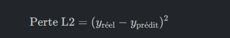

# 2026-08-24

## Ce que j'ai appris
- on ne doit pas donner l'intégralité de nos données pour entraîner le modèle. Si on entraînait le modèle sur la totalité des données, il pourrait simplement les mémoriser par cœur, et nous n'aurions aucun moyen de savoir s'il est capable de bien réagir face à de nouvelles données (ce qu'on appelle sa capacité de généralisation).

    Pour résoudre ce problème, on divise notre jeu de données en trois parties distinctes (généralement selon des proportions de 60% / 20% / 20% ou 80% / 10% / 10%) :

 1. L'ensemble d'entraînement (Training dataset): C'est la partie la plus importante en quantité.

        - Rôle : Elle sert à apprendre au modèle.
        - Fonctionnement : On injecte ces données dans le modèle pour qu'il fasse des prédictions
On compare ensuite ses résultats avec les vraies réponses pour calculer l'erreur (la perte ou loss)
 C'est à partir de cette perte que l'on effectue des ajustements sur le modèle (ce qu'on appelle la phase d'entraînement ou training).

 2. L'ensemble de validation (Validation dataset).

 Cette partie sert de "reality check" (un contrôle de réalité) pendant ou juste après l'entraînement.

- Rôle : S'assurer que le modèle reste capable de traiter des données qu'il n'a pas encore vues

- Fonctionnement : À chaque étape de l'entraînement, on fait passer l'ensemble de validation dans le modèle pour mesurer l'erreur
 Cependant, on n'ajuste pas le modèle en fonction des erreurs faites sur cet ensemble (la boucle de rétroaction reste ouverte).

- Utilité : Cet ensemble permet également de comparer différents modèles (par exemple un modèle A, B, C ou D ayant des configurations différentes) afin de sélectionner celui qui commet le moins d'erreurs (la perte la plus faible).

3. L'ensemble de test (Testing dataset)

C'est le contrôle final

- Rôle : Évaluer de manière totalement neutre et objective la performance du modèle que vous avez choisi à l'étape précédente
.
- Fonctionnement : On utilise cet ensemble uniquement à la toute fin sur le modèle sélectionné
Ces données n'ont absolument jamais été présentées au modèle à aucun moment de son entraînement ou de sa sélection
Résultat : L'erreur calculée sur cet ensemble de test représente la performance finale officielle de votre modèle.

### C'est quoi une Loss Function 
    Une Loss Function represente numériquement l'écart ou la différence entre la prédiction faite par votre modèle et la réalité (l'étiquette réelle) .
    - Le principe : Si votre modèle fait une excellente prédiction, la perte est très faible.
    S'il se trompe complètement, la perte est élevée.
    - L'objectif : Pendant l'entraînement, le but absolu est de minimiser cette perte (la faire descendre le plus proche possible de zéro).C'est ainsi que le modèle apprend à devenir plus précis.

    Pour mesurer cette perte, on utilise différentes formules mathématiques appelées "fonctions de perte"
    Kylie Ying en présente trois principales :

        1. La perte L1 (L1 Loss)Cette fonction est principalement utilisée pour les problèmes de régression (prédiction de valeurs numériques continues).
        
        - Comment elle fonctionne : Elle calcule la valeur absolue de la différence entre la valeur réelle et la valeur prédite6 : 

                    Perte L1 = |Yréel - Yprédit|
        Exemple concret : Si la valeur réelle est éloignée de votre prédiction de $10$ unités (que ce soit en trop ou en moins), la perte pour ce point précis sera de 10.
        
        - Calcul global : Pour l'ensemble du jeu de données, la fonction fait la somme de toutes ces différences absolues pour mesurer l'erreur totale. Plus vous êtes loin de la réalité, plus la perte augmente de façon linéaire.

        2.  La perte L2 (L2 Loss)
            C'est une autre fonction très classique pour la régression, mais elle est quadratique
            .
            - Comment elle fonctionne : Au lieu d'utiliser la valeur absolue, elle élève la différence au carré: 

            

            - La différence clé avec la L1 : Le fait d'élever au carré change complètement la pénalité :
 
                    - Si l'erreur est petite (inférieure à 1), la pénalité est très minime

                    - Si l'erreur est grande, la pénalité devient extrêmement élevée

            - Effet : La perte L2 est particulièrement utile si vous voulez que votre modèle évite à tout prix de faire de  très grosses erreurs, car elle les punit beaucoup plus sévèrement que la perte L1.

        3- La perte d'entropie croisée binaire (Binary Cross Entropy Loss)
            Cette fonction est utilisée spécifiquement pour les tâches de classification binaire (lorsque le modèle doit choisir entre deux catégories uniquement, comme "diabétique" ou "non-diabétique", ou "0" et "1").

            Le principe : Elle évalue la capacité du modèle à prédire correctement la bonne classe
            . Plus le modèle attribue une probabilité correcte à la bonne classe, plus cette perte diminue

## Erreurs rencontrées
- None

## Demain
- Cross-validation